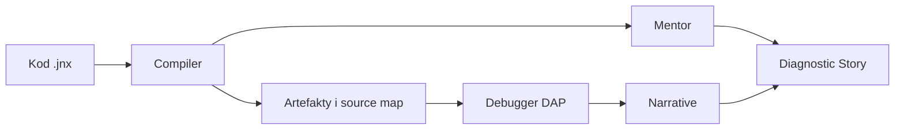

# Junexis Studio — podręcznik użytkownika

Jeśli uruchamiasz Studio po raz pierwszy, zacznij od
[pierwszych 10 minut](GETTING_STARTED.md). Pełna lista klawiszy znajduje się w
[skrótach klawiaturowych](KEYBOARD_SHORTCUTS.md), a diagnozowanie awarii w
[Troubleshooting](TROUBLESHOOTING.md).

Junexis Studio jest zintegrowanym środowiskiem dla projektów Junexis oraz kodu
C++, Go, C# i TypeScript używanego lub generowanego przez platformę.

Studio łączy cztery rodzaje informacji:



Kompilator odpowiada za poprawność i generowanie. DAP pokazuje bieżący stan
procesu. Narrative rekonstruuje przyczynowość runtime. Mentor interpretuje
strukturę projektu. Studio prezentuje te dowody razem, nie zamieniając jednego
rodzaju dowodu w drugi.

## Uruchomienie ze źródeł

Uruchomienie ze źródeł wymaga workspace opisanego w sekcji
[Szybki start w README](../README.md#szybki-start); sam klon tego repo nie
zawiera jeszcze wszystkich zależności potrzebnych do zbudowania pełnej solucji.

Z katalogu nadrzędnego platformy:

```powershell
dotnet run --project .\junexis-studio\src\Shell\Junexis.Studio.Shell.csproj
```

Studio przywraca ostatnio otwarty, nadal istniejący folder. Nie używa katalogu
uruchomieniowego procesu jako projektu. Gdy nie ma poprawnej historii, Explorer
pokazuje **Otwórz folder**, **Klonuj repozytorium** oraz dostępne ostatnie
foldery. Dialogi wyboru rozpoczynają w katalogu domowym użytkownika.

Szczegółowy przebieg, w tym obsługę niezapisanych dokumentów i regułę `.git`,
opisuje [Workspace i repozytorium — pełny przepływ](WORKSPACE_REPOSITORY_WORKFLOW.md).

## Pierwsza orientacja

Najważniejsze obszary:

- **Explorer** — pliki workspace,
- **Editor** — źródła `.jnx` i języków docelowych,
- **Problems** — diagnostyki kompilatorów,
- **Output** — logi z podziałem na kanały,
- **Terminal** — polecenia uruchamiane w kontekście workspace,
- **Artifacts** — wynikowy manifest artefaktów,
- **Analysis** — symbole, komunikacje, topologia i Mentor,
- **Toolchains** — dostępność compilerów i debuggerów; panel ma nagłówek
  „Toolchain Doctor”,
- **Debug** — konfiguracje launch/attach, breakpointy, stos i zmienne,
- **Why?** — historia przyczynowa Narrative.

Układ jest zbliżony do VS Code: Explorer zajmuje pełną lewą kolumnę, edytor
centrum, narzędzia ogólne są pod edytorem, a **Debug**, **Changes**, **OMWiA**
i **OMWiA Chat** znajdują się w panelu prawym. Studio zapamiętuje szerokości
paneli, wysokość panelu dolnego oraz ostatnio wybraną zakładkę dolną i prawą.
Nagłówki paneli pozostają w jednym rzędzie; przycisk `…` otwiera listę
wszystkich zakładek także wtedy, gdy część nie mieści się w dostępnej szerokości.

Bez otwartego workspace Explorer i prawy panel są początkowo zwinięte, aby nie
powielać centralnego Start Center. Wybranie Explorera, Search, Source Control
lub Run and Debug rozwija właściwy obszar. Ponowne wybranie aktywnej
perspektywy zwija go bez utraty zapamiętanego rozmiaru.

### Szybka nawigacja

- `Ctrl+P` — **Quick Open**: wyszukuje plik po nazwie, fragmencie ścieżki lub
  skróconym fuzzy matchingu i otwiera go w edytorze. Indeks nie obejmuje
  katalogów technicznych, takich jak `.git`, `bin`, `obj` i `node_modules`.
- `Ctrl+Shift+P` — **Command Palette**: przeszukuje aktualnie dostępne
  polecenia Studio, pokazuje ich kategorię, identyfikator oraz aktywny skrót.

W obu oknach strzałki zmieniają wybór, `Enter` wykonuje akcję, a `Esc` zamyka
paletę. Jeśli `Ctrl+P` zostanie użyte bez aktywnego workspace, Studio rozpocznie
przepływ **Open Folder**.

### Start Center

Gdy wszystkie karty edytora są zamknięte, jego centralny obszar zmienia się w
ekran startowy. Pokazuje aktualny folder i informację, czy jest on kontekstem
Git, oraz wspólną z Explorerem listę ostatnich workspace.

Sekcja **Start** prowadzi do otwierania folderu, klonowania, Quick Open i palety
poleceń. Sekcja **Understand** aktywuje Toolchain Doctor, panel analizy z
Mentorem, Narrative **Why?** oraz **Help Center**. Ekran znika automatycznie po
otwarciu pliku i wraca po zamknięciu ostatniej karty.

### Pomoc w aplikacji

Menu **Help** otwiera zadaniowe tematy:

- Getting Started,
- Keyboard Shortcuts,
- Build, Run and Debug,
- Git Workflow,
- Troubleshooting.

Help Center pokazuje krótką sekwencję kroków, kryteria sukcesu i ścieżkę
pełnego dokumentu. Z jego dolnego paska można bezpośrednio otworzyć folder,
uruchomić Toolchain Doctor oraz przejść do Problems i Output. Wszystkie tematy
są również poleceniami w `Ctrl+Shift+P`.

### Activity Bar

Wąska pionowa szyna przy lewej krawędzi zapewnia stały dostęp do głównych
perspektyw pracy:

| Obszar | Skrót | Działanie |
|---|---|---|
| Explorer | `Ctrl+Shift+E` | aktywuje albo zwija panel plików |
| Search | `Ctrl+Shift+F` | przeszukuje cały workspace |
| Problems | `Ctrl+Shift+M` | otwiera diagnostyki w panelu dolnym |
| Source Control | `Ctrl+Shift+G` | aktywuje zmiany Git po prawej |
| Run and Debug | `Ctrl+Shift+D` | aktywuje konfiguracje i sesję DAP |
| Narrative Why | — | otwiera historię przyczynową |

Wskaźnik przy ikonie śledzi również ręczne przełączanie zakładek. Wielokrotne
wybranie aktywnego Explorera zwija lewą kolumnę bez utraty jej zapamiętanej
szerokości. Ta sama reguła dotyczy prawego panelu Debug i Source Control.
Problems pokazuje badge z liczbą diagnostyk, a Source Control z liczbą
zmienionych ścieżek repozytorium; wartości powyżej 99 są prezentowane jako
`99+`. Przycisk na dole szyny otwiera Command Palette. Ikony głównych
perspektyw, operacji, wyszukiwania, Explorera i terminala pochodzą z jednego
zestawu wektorowego — nie zmieniają kształtu wraz z czcionką systemową.
Aktywny obszar ma tło i lewy akcent, a nawigacja klawiaturą pokazuje focus.

### Globalne wyszukiwanie

Użyj `Ctrl+Shift+F` albo ikony lupy w Activity Bar. Search zastępuje Explorer w
lewej kolumnie i automatycznie ustawia fokus w polu zapytania.

- `Enter` uruchamia wyszukiwanie, a `Esc` lub przycisk Stop je anuluje.
- **Files to include** przyjmuje wzorce rozdzielone przecinkiem lub średnikiem,
  np. `*.jnx, src/**`.
- **Files to exclude** ogranicza ścieżki, np. `generated/**, tests/**`.
- **Match case** przełącza rozróżnianie wielkości liter.
- Wyniki są grupowane według pliku; kliknięcie trafienia otwiera dokładną linię
  i kolumnę w edytorze.

Niezależnie od filtrów użytkownika Studio nie przeszukuje `.git`, `.svn`,
`.hg`, `.vs`, `.idea`, `.junexis`, `bin`, `obj` ani `node_modules`. Pomijane są
również pliki binarne i pliki większe niż 2 MiB. Jedno wyszukiwanie zwraca
maksymalnie 2000 trafień i jawnie informuje o osiągnięciu limitu.

## Otwieranie i klonowanie projektu

### Otwórz folder

Użyj **Workspace → Open Folder...** albo przycisku na pustym Explorerze.
Pełna ścieżka aktywnego folderu jest widoczna na pasku stanu. Przy zmianie
workspace każda niezapisana karta oferuje **Save**, **Discard** albo
**Cancel**. Anulowanie pozostawia poprzedni workspace bez zmian.

### Klonuj repozytorium

Użyj **Workspace → Clone Repository...** albo przycisku na ekranie powitalnym:

1. podaj URL HTTPS lub SSH,
2. wybierz katalog nadrzędny,
3. obserwuj postęp w kanale **Git Clone**,
4. po sukcesie Studio automatycznie otworzy sklonowany katalog.

Studio nie nadpisuje istniejącego katalogu docelowego. URL jest przekazywany
do Git jako osobny argument i maskowany w logach procesu.

### Folder a repozytorium Git

Każdy istniejący katalog może być workspace. Kontekst Git aktywuje się tylko,
gdy wskazany katalog zawiera bezpośrednio katalog albo plik `.git`. Otwarcie
podkatalogu repozytorium nie aktywuje Git z katalogu nadrzędnego. W takim
przypadku otwórz katalog główny repozytorium.

## Praca z projektem Junexis

### Otwieranie

Otwórz katalog zawierający `junexis.project.toml`. Następnie otwórz plik
wejściowy, zwykle `src/main.jnx`.

Jeśli workspace nie ma manifestu, Studio może zbudować aktywny pojedynczy plik
`.jnx`. Dla realnych systemów zalecany jest projekt z manifestem.

### Build

`F6` lub **Build → Build** wybiera compiler na podstawie aktywnego dokumentu:

| Rozszerzenie | Profil |
|---|---|
| `.jnx` | Junexis compiler |
| `.cpp`, `.cc`, `.cxx`, `.c` | G++ |
| `.go` | Go |
| `.cs`, `.csproj`, `.sln` | .NET |
| `.ts`, `.tsx`, `.js`, `.jsx` | TypeScript/Node |

Build Junexis publikuje atomowy kontrakt
`.junexis/state/latest-build.json` ze wspólnym `buildId` oraz ścieżkami do
manifestów. Studio najpierw waliduje wersję kontraktu, zgodność ścieżek,
istnienie plików oraz wspólny `buildId` bundle, inventory i Analysis Snapshot,
a dopiero potem odświeża panele **Artifacts**, **Analysis**, **Mentor** i mapę
debuggera. Nie wyszukuje „najnowszego” katalogu output.

Po ponownym uruchomieniu Studio otwarcie projektu z manifestem odtwarza ostatni
poprawny build z receiptu. Uszkodzony lub niepełny receipt nie jest zgadywany:
szczegóły pojawiają się w kanale **Build**, a panele zachowują stan bez
publikowania niespójnych danych. Tryb pojedynczego pliku używa izolowanej
ścieżki `.junexis/state/<nazwa-pliku>/latest-build.json`.

Przed generowaniem C++, Go lub TypeScript Studio wykonuje właściwy preflight:

1. compiler sprawdza źródło i tworzy tymczasowy Analysis Snapshot bez codegenu,
2. Mentor analizuje snapshot i pokazuje krótką deltę,
3. compiler generuje targety z tym samym `buildId`.

Błąd compilera w pierwszej fazie zatrzymuje build. Finding Mentora — również o
wadze `Error` — nie jest błędem języka i nie blokuje generowania. Brak albo
uszkodzona odpowiedź Mentor CLI jest zapisywana w kanale **Mentor** jako
`unavailable; build continues`. Wszystkie fazy reagują na to samo polecenie
**Stop**.

### Deploy Center

Panel **Deploy** jest baseline'em `M7.5` dla jawnego przepływu deploymentowego
w Studio. Działa tylko wtedy, gdy bieżący projekt ma zweryfikowany
`.junexis/state/latest-build.json`; Studio nie szuka samodzielnie „ostatniego”
bundla ani nie zgaduje stanu outputu.

Przepływ panelu jest celowo wąski:

- **Refresh** ponownie wczytuje verified receipt dla aktywnego kontekstu.
- **Prepare** uruchamia `junexis package`, a następnie `junexis deploy preflight`
  dla deployowalnych targetów z dokładnie tym samym `buildId`.
- **Run Local** uruchamia bounded `junexis deploy local` tylko dla `server`
  i `report`, po technicznie gotowym preflight.
- **Adopt Session** jawnie przejmuje orphaned live session do bieżącej
  tożsamości Studio, gdy obcy owner lease nie jest już aktywny.
- **Stop Local** przerywa bieżącą bounded sesję Studio albo zatrzymuje
  przejętą live session przez canonical `deployment-session` contract.

Sekcja **Bundle authenticity** (`M7.9`) oddziela integralność ZIP-a od podpisu
i lokalnej decyzji zaufania. Przed **Prepare** wybierz jedną politykę:

- `permissive` dopuszcza brak podpisu oraz poprawny podpis, lecz nigdy podpis
  niepoprawny;
- `signed` wymaga poprawnego podpisu;
- `trusted` wymaga poprawnego podpisu, którego fingerprint SHA-256 został jawnie
  wpisany do pola zaufanych podpisujących.

Opcjonalna ścieżka klucza wskazuje zewnętrzny PEM ECDSA P-256, a **Signer name**
jest jego jawną etykietą. Oba pola muszą wystąpić razem. Studio przekazuje klucz
wyłącznie do procesu `junexis package`; nie kopiuje go do projektu, ZIP-a,
receiptów ani ustawień. Po preflight panel pokazuje niezależnie stan
`unsigned`, `verified`, `trusted` albo `invalid`, zastosowaną politykę oraz
fingerprint. Mentor pozostaje opinią nieblokującą i nie zastępuje podpisu.
Wybrana polityka obejmuje również **Prepare Embedded**; CLI sprawdza ją ponownie
przed jakąkolwiek ekstrakcją i komendą uploadu PlatformIO.

Panel pokazuje `buildId`, targety obsługiwane przez local flow oraz targety z osobnym
przepływem, wynik ostatniego
preflightu, wynik ostatniej sesji lokalnej, per-target status/details, ścieżkę zapisanego
`deployment-receipt.json`, bieżący `Recovery mode` oraz skrócony log procesu. Baseline `M7.6`
obejmuje trwały receipt bounded local session oraz odtworzenie ostatniego local
deployment snapshot po `Refresh` dla bieżącego verified build, razem z jawnym
`status`, `exit code`, `duration` i ścieżką receipt. Jeśli deterministyczny
bundle oraz preflight nadal istnieją, Studio przywraca też prepared deploy
state i pozwala ponownie uruchomić bounded `Run Local` bez kolejnego `Prepare`.
Panel rozróżnia teraz jawnie `No restored state`, `Historical snapshot`,
`Snapshot only`, `Rerunnable prepared state`, `Current Studio session` oraz
`Live resumable session`. Dla własnej live session Studio odnawia lease w tle,
a po refresh potrafi przywrócić owner-aware status, heartbeat i per-target
evidence z `deployment-session.json`. CLI publikuje też `deployment-session.json`,
a `junexis deploy local status --session`, `adopt --session` i owner-aware
`stop --session` pozostają kanonicznym backendem dla tego flow. Pełny restart
żywego runtime po utracie procesu ownera i szerszy cross-host resume nadal
pozostają poza zakresem.
Sesja zapisuje PID długotrwałego procesu Studio. Odnowienie lease przez ten sam
host nie jest traktowane jak ponowna adopcja. Zatrzymanie targetu wymaga zgodności
PID, czasu startu i ścieżki executable, a aktywny health probe jest ograniczony
do HTTP loopback i `/health/ready`.
Embedded `M7.7` ma w Deploy Center osobną sekcję i nie korzysta z przycisku
**Run Local**. Bezpieczna kolejność pracy to:

1. **Probe Devices** wykonuje read-only discovery przez PlatformIO. Studio nie
   wybiera automatycznie nawet jedynego wykrytego urządzenia.
2. Operator wskazuje urządzenie na liście i używa **Select Device**. CLI wykonuje
   świeży probe i zapisuje deterministyczny kontrakt wyboru.
3. **Prepare Embedded** pakuje wyłącznie target `embedded`; package receipt musi
   zachować `buildId` bieżącego verified builda.
4. Operator zaznacza osobne potwierdzenie fizycznego flashowania. Dopiero wtedy
   aktywuje się **Flash Selected Device**.
5. CLI ponownie weryfikuje bundle, receipt i wybór, a wynik zapisuje jako
   `.junexis/state/deploy/<buildId>/embedded/embedded-flash-receipt.json`.

Zmiana zaznaczonego urządzenia, ponowny probe, zmiana builda oraz zakończenie
próby flash resetują zgodę. Ścieżkę PlatformIO można ustawić przez
`JUNEXIS_PLATFORMIO_EXE`; wartością domyślną jest `pio`. Brak fizycznej płytki
nie blokuje pracy nad pozostałymi targetami.
W snapshotach live session panel nie pokazuje już wyłącznie surowych znaczników
UTC. Wprost klasyfikuje lease jako `Lease valid for`, `Lease renews soon` albo
`Lease expired`, a heartbeat jako `Heartbeat is fresh` albo `Heartbeat is stale`,
żeby operator od razu widział, czy sesja jest zdrowa, dryfuje, czy kwalifikuje
się do jawnego `Adopt Session`.

### Pasek Run & Debug

Pod menu znajduje się wspólny pasek bieżącego uruchomienia. Pokazuje nazwę
workspace i aktywnego pliku, a profil dobiera automatycznie po rozszerzeniu.
Profil można zmienić ręcznie, gdy świadomie chcesz uruchomić inne narzędzie.

- **Build**, **Run** i **Debug** wykonują polecenie wybranego profilu.
- Przed akcją Studio korzysta z ostatniego wyniku Toolchain Doctora, a jeśli
  go jeszcze nie ma — uruchamia kontrolę automatycznie.
- Brak wymaganej capability zatrzymuje operację, zapisuje wyjaśnienie w
  **Output** i otwiera **Toolchain Doctor**.
- Tekst obok profilu pokazuje gotowość, brakujące narzędzia oraz stan builda
  lub autorytatywny stan sesji DAP.
- **Stop** wysyła wspólne żądanie zatrzymania, a skróty po prawej otwierają
  **Problems** i **Output**.
- **Why?** jest aktywne dopiero, gdy debugger potwierdzi stan `Stopped`.

Obsługiwane profile to Junexis, C#/.NET, C/C++, Go oraz TypeScript
(`.ts`, `.tsx`). Nie każda operacja istnieje dla każdego profilu: na przykład
profil Junexis obecnie buduje artefakty, a uruchomienie i debugowanie dotyczą
wybranego języka docelowego.

### Lifecycle operacji

Wszystkie wbudowane rozszerzenia compilerów i rozszerzenie debuggera DAP
publikują ten sam autorytatywny stan:

`Starting → Running → Succeeded | Failed | Cancelled`

Snapshot zawiera identyfikator operacji, profil, rodzaj Build/Run/Debug, czas
startu i zakończenia, czas trwania, exit code oraz liczbę diagnostyk. Nowsza
operacja nie może zostać nadpisana przez spóźnione zakończenie starszego
procesu. Start konfiguracji `launch` albo `attach`, przejście adaptera do
`Running`/`Stopped`, zakończenie i błąd są odwzorowane na ten sam lifecycle.
Jawne **Stop Debugging** kończy operację jako `Cancelled`.

Po niepowodzeniu z diagnostykami Studio otwiera **Problems**. Jeśli proces
zawiódł bez diagnostyk strukturalnych, aktywowany jest **Output**. Szczegółowy
stan DAP pozostaje autorytatywnym źródłem dla stosu, zmiennych, breakpointów
i narracyjnego **Why?**.

### Interpretacja wyników

- **Problems** odpowiada na pytanie „co jest niepoprawne?”.
- **Artifacts** odpowiada „co wygenerowano i do jakiego targetu?”.
- **Analysis** odpowiada „jakie symbole i relacje widzi kompilator?”.
- **Mentor** odpowiada „jakie ryzyka wynikają ze struktury projektu?”.
  W zakładkach **Findings**, **Insights** i **Patterns** pokazuje odpowiednio
  problemy z uzasadnieniem i następną akcją, obserwacje architektoniczne oraz
  rozpoznane wzorce. Podwójne kliknięcie findingu przechodzi do źródła.

Zakładka **Conformance** pokazuje status `SATISFIED` albo `PARTIAL`, liczbę
scenariuszy spełniających indywidualny target oraz każdą lukę jako
`achievedLevel → targetLevel`. Studio szuka `semantic-conformance.json` przy
snapshotcie, w `out/`, `.junexis/` i katalogu projektu. Luki nie trafiają do
Problems i nie zmieniają rezultatu builda. Raport 0.2 związany z konkretnym
wydaniem pokazuje `BOUND` oraz skróty Build ID i Bundle ID. Raport 0.1 jest
jawnie `UNBOUND`. Niezgodny Build ID nie jest prezentowany jako aktualna opinia.

Podwójne kliknięcie symbolu, relacji lub findingu z pozycją źródłową otwiera
odpowiednie miejsce kodu.

### Stopniowana obecność Mentora

Mentor jest doradcą architektonicznym, a nie drugim kompilatorem. Nie otwiera
modalnych komunikatów. Jego kanonicznym miejscem jest zakładka **Mentor** w
panelu **Analysis**.

Domyślny tryb **Teaching** pokazuje dodatkowo wyjaśnienie oraz zalecany następny
krok. Studio pokazuje też poziom obecności, świeżość, wersję schematu,
skrócony build ID i czas analizy oraz porównuje wynik z poprzednią bieżącą
analizą oraz raportuje findings nowe, zmienione i rozwiązane. Wynik ze starym
albo brakującym build ID jest oznaczany jako **Stale** lub **Unknown** i nie
zastępuje bieżącego baseline'u.

Tryb wybiera się w **Preferences → Mentor → Presence**:

- **Teaching** — poziom początkujący: werdykt, wyjaśnienie i następny krok,
- **Balanced** — poziom średniozaawansowany: zwięzłe opinie w momentach decyzji,
- **Quiet** — poziom ekspercki: znacznik i panel bez automatycznych podsumowań.

Preflight przed generowaniem artefaktów jest częścią Etapu 30.2. Bezpieczne
refaktoryzacje `M1002` i `M1012` są dostępne wyłącznie z podglądem diffu,
kontrolą kompilatora oraz jawną decyzją `Keep/Revert`. `M1012` jest oferowane
tylko dla odłączonej Narrative i dokładnie jednego pipeline'u. Kompilator
pozostaje źródłem prawdy o poprawności, a Narrative o przyczynowości runtime.

### Mentor przy diagnostyce compilera

Po wybraniu diagnostyki Junexis panel **Problems** może pokazać oddzielną
sekcję **Mentor · Current**. Nie zmienia ona komunikatu, kodu ani severity
compilera. Zawiera:

- kody powiązanych findings,
- jawny dowód: dokładna deklaracja, stable symbol ID i skrócony build ID,
- wyjaśnienie znaczenia dla systemu,
- najmniejszy bezpieczny następny krok,
- przycisk **Open full Mentor report**.

Sekcja pojawia się tylko wtedy, gdy diagnostyka ma stabilny kod, jej linia
dokładnie odpowiada deklaracji symbolu w bieżącym Analysis Snapshot, finding
wskazuje ten sam symbol i wszystkie dane mają zgodny `buildId`. Studio nie
zgaduje na podstawie „najbliższej” deklaracji. Brak takiego dowodu oznacza brak
komentarza Mentora. Tryb **Quiet** zachowuje kontekst wyłącznie w panelu
Analysis.

Pełna filozofia, zasady zaufania, szybki start i kontrakt rozwoju Mentora
znajdują się w osobnym podręczniku projektu.

## Usługi językowe i LSP

Studio uruchamia serwer językowy leniwie po otwarciu pierwszego obsługiwanego
pliku. Synchronizuje pełny lifecycle dokumentu: otwarcie, zmiany, zapis i
zamknięcie. Diagnostyki LSP pojawiają się w panelu **Problems**.

| Pliki | Serwer |
|---|---|
| `.jnx` | Junexis Language Server |
| `.c`, `.cpp`, `.h`, `.hpp` i warianty | `clangd` |
| `.go` | `gopls` |
| `.ts`, `.tsx`, `.js`, `.jsx` i warianty | `typescript-language-server --stdio` |

Najważniejsze akcje edytora:

- `Ctrl+Space` — completion; dla Junexis listę wyzwalają także `.`, `:`, `<` i `@`,
- hover wskaźnikiem — opis symbolu; podczas zatrzymanej sesji pierwszeństwo ma
  wartość z debuggera,
- `F12` — przejście do definicji,
- `Shift+F12` — wyszukanie referencji i otwarcie ich w panelu
  **Language Services**,
- `F2` — zmiana nazwy symbolu we wszystkich dokumentach zwróconych przez
  serwer; otwarte karty pozostają oznaczone jako zmienione,
- `Ctrl+.` — pobranie akcji dla bieżącej pozycji i zastosowanie wybranej
  edycji; gdy serwer zwraca kilka propozycji, Studio pozwala podać ich numer,
- **Tools → Restart Language Server** — ręczny restart profilu aktywnego pliku.

Kolory identyfikatorów są dodatkowo wzbogacane przez semantic tokens LSP.
Oznacza to, że serwer może odróżnić między innymi typ, funkcję, zdarzenie,
zmienną, operator i dekorator niezależnie od bazowego kolorowania składni.
Rename i Quick Fix należy po zastosowaniu przejrzeć przed zapisem, szczególnie
w przypadku serwerów oferujących heurystyczne refaktoryzacje.

Po nieoczekiwanym zakończeniu procesu Studio automatycznie podejmuje dwie próby
restartu i ponownie otwiera zsynchronizowane dokumenty.

Panel **Language Services** jest dostępny także przez
**View → Language Services**. Pokazuje stan każdego profilu, komunikat
lifecycle, liczbę restartów i ostatni wynik referencji. Zaznacz profil i użyj
**Restart selected**, aby uruchomić go ponownie niezależnie od aktywnego pliku.
Podwójne kliknięcie referencji otwiera dokładną linię i kolumnę.

### Diagnostyki w edytorze

Problemy ze wspólnego magazynu Studio są widoczne bezpośrednio w kodzie:

- czerwone podkreślenie i punkt na marginesie — błąd,
- żółte podkreślenie i trójkąt — ostrzeżenie,
- niebieskie podkreślenie i punkt — informacja,
- najechanie na problem pokazuje poziom i pełny komunikat,
- `F8` przechodzi do następnego problemu,
- `Shift+F8` przechodzi do poprzedniego problemu.

Nawigacja zawija się przez diagnostyki wszystkich plików. Panel **Problems**
pozostaje pełną listą i źródłem nawigacji przez podwójne kliknięcie.

## Toolchain Doctor

Pasek Run & Debug automatycznie wykonuje pierwszy preflight. Doctor można też
odświeżyć ręcznie, aby wcześniej przygotować środowisko:

1. otwórz panel **Toolchains**,
2. wybierz **Refresh**,
3. sprawdź compiler, Mentor i .NET,
4. sprawdź tylko te toolchainy targetów, których zamierzasz używać.

Doctor rozróżnia compiler/runtime od adaptera DAP. Obecność `g++` nie oznacza
jeszcze, że dostępny jest adapter debuggera C++.

Najważniejsze nadpisania środowiska:

LSP zainstalowany przez `junexis install --lsp` jest wykrywany automatycznie w
`%LOCALAPPDATA%\Junexis\lsp`; zmienna `JUNEXIS_LSP` służy tylko do świadomego
nadpisania tej ścieżki.

| Zmienna | Znaczenie |
|---|---|
| `JUNEXIS_COMPILER_CLI` | executable albo DLL kompilatora |
| `JUNEXIS_CLI` | publiczny executable `junexis` używany przez komendy odtwarzania zależności |
| `JUNEXIS_LOCAL_PACKAGES` | opcjonalny lokalny zestaw wydania przekazywany do `junexis restore --local-packages` |
| `JUNEXIS_REGISTRY` | opcjonalny bazowy adres HTTPS Registry przekazywany do `junexis restore --registry` |
| `JUNEXIS_MENTOR_CLI` | executable albo DLL Mentora |
| `JUNEXIS_LSP` | jawnie wskazany plik serwera Junexis LSP; instalacja użytkownika i wersja deweloperska są wykrywane automatycznie |
| `JUNEXIS_CLANGD` | executable `clangd` |
| `JUNEXIS_GOPLS` | executable `gopls` |
| `JUNEXIS_TYPESCRIPT_LSP` | executable `typescript-language-server` |
| `JUNEXIS_GXX` | G++ |
| `JUNEXIS_GDB` | GDB |
| `JUNEXIS_DLV` | Delve |
| `JUNEXIS_CPP_DAP` | adapter C++ DAP |
| `JUNEXIS_GO_DAP` | adapter Go DAP |
| `JUNEXIS_TYPESCRIPT_DAP` | adapter TypeScript DAP |

Dla adapterów można również ustawić sufiksy `_ARGS`, `_TYPE` i `_TRANSPORT`.
Transport ma wartość `stdio` albo `tcp`; argumenty TCP zawierają `{port}`.

## Odtwarzanie zależności projektu Junexis

Studio udostępnia w menu **Build** polecenia **Odtwórz zależności Junexis**
oraz **Odtwórz zależności Junexis offline**. Oba uruchamiają jedno publiczne
`junexis restore` dla otwartego projektu. Nie wywołują bezpośrednio prywatnego
CLI compilera.

Zwykłe odtwarzanie korzysta z Registry wskazanego przez `JUNEXIS_REGISTRY`, a
bez tej konfiguracji może użyć lokalnego zestawu wydania wskazanego przez
`JUNEXIS_LOCAL_PACKAGES`. Tryb offline nie czyta zdalnego indeksu i wymaga
zgodnego `junexis.packages.lock`, kompletnej pamięci podręcznej projektu oraz
providerów już dostępnych w profilu użytkownika.

W dystrybucji Studio Installer jest dołączony w `tools/junexis` i wykrywany
automatycznie. `JUNEXIS_CLI` służy do świadomego wskazania innego publicznego
pliku wykonywalnego, na przykład podczas pracy z repozytorium. W danej chwili
może działać tylko jedno odtwarzanie; zamknięcie rozszerzenia anuluje operację.
Przebieg i błędy są widoczne w kanale **Output → Restore**.
Studio pokazuje kolejno przygotowanie wraz z bezpieczną nazwą źródła,
pobieranie i weryfikację oraz wynik operacji. Sam adres Registry nie jest
powtarzany w komunikacie etapu. W trybie offline jedynym źródłem jest lokalna
pamięć podręczna; Studio nie przekazuje wtedy adresu Registry ani lokalnego
zestawu wydania.

Szczegółowy kontrakt tej integracji opisuje
[`m17-11-1-restore-progress.md`](m17-11-1-restore-progress.md), a diagnostyki i
działania naprawcze —
[`m17-11-2-restore-diagnostics.md`](m17-11-2-restore-diagnostics.md).
Zachowanie podczas zamykania i ponowienia opisuje
[`m17-11-3-cancel-retry.md`](m17-11-3-cancel-retry.md).

Standalone `js-debug` instaluje:

```powershell
pwsh -File .\junexis-studio\scripts\install-js-debug.ps1
```

## Uruchamianie i debugowanie

### Domyślne skróty

| Skrót | Komenda |
|---|---|
| `F5` | Run |
| `F6` | Build |
| `F7` | Debug |
| `F9` | Toggle Breakpoint |
| `F10` | Step Over |
| `F11` | Step Into |
| `Shift+F11` | Step Out |
| `Ctrl+F10` | Run to Cursor |
| `Shift+F5` | Stop |

### Konfiguracje

Panel **Debug** tworzy trzy początkowe profile:

- Launch C++,
- Launch Go,
- Launch TypeScript / Node.

Konfiguracja może działać jako:

- `Launch` — Studio uruchamia proces i jest jego właścicielem,
- `Attach` — Studio podłącza się do istniejącego PID-u.

Przy `Attach` odłączenie wysyła `terminateDebuggee=false`, więc Studio nie
powinno zakończyć obserwowanego procesu.

Konfiguracje są zapisywane w `.junexis/studio-debug.json`.

### Breakpointy i source map

Build Junexis publikuje `debug/junexis.source-map.json`. Dzięki temu:

- breakpoint `.jnx` może zostać wysłany do wielu lokalizacji wygenerowanych,
- ramka C++/Go/TypeScript wraca do stabilnego symbolu i instrukcji `.jnx`,
- panel pokazuje, czy adapter potwierdził, przesunął lub odrzucił breakpoint.

Breakpoint może mieć `condition`, `hitCondition` i `logMessage`. Studio
obsługuje także filtry wyjątków reklamowane przez adapter.

### Zmienne, watches i Debug Console

Po zatrzymaniu Studio:

- wybiera pierwszą ramkę,
- ładuje scopes i preferuje `Locals`,
- pokazuje drzewa zmiennych,
- odświeża watches,
- umożliwia `evaluate` po najechaniu na prostą nazwę lub łańcuch pól.

Debug Console używa DAP `evaluate` z kontekstem `repl`. Jeśli adapter wspiera
`setVariable` i data breakpoints, panel udostępnia również te operacje.

## Narrative: „Why did this happen?”

DAP i Narrative odpowiadają na różne pytania:

- DAP: „gdzie proces jest teraz i jakie ma wartości?”,
- Narrative: „jakie zdarzenia doprowadziły do tego stanu?”.

Wymagania:

1. TraceCollector działa pod adresem ustawionym w panelu **Why?**,
2. został uruchomiony z debug manifestem tego samego projektu,
3. runtime wysłał zdarzenia,
4. zatrzymana ramka ma stabilny symbol albo dokładną lokalizację `.jnx`.

### Zarządzana sesja Narrative

Po poprawnym buildzie Studio automatycznie:

1. odczytuje zweryfikowany `latest-build.json`,
2. uruchamia TraceCollector wyłącznie na `127.0.0.1` z debug manifestem tego
   builda,
3. czeka na potwierdzenie `/health`,
4. monitoruje liczbę zdarzeń,
5. wybiera najnowszy event, którego `build_id` odpowiada aktywnemu buildowi;
   historia po pierwszym wyborze zachowuje też dokładny `bundle_id`.

Pasek **Session** w panelu Why pokazuje stan i udostępnia **Start**,
**Refresh** oraz **Stop**. Pole URL nadal może wskazywać zewnętrzny Collector;
Studio nie przejmuje ani nie zatrzymuje procesu, którego samo nie uruchomiło.

Przepływ:

1. zatrzymaj debugger,
2. wybierz **Why did this happen?** w panelu Debug,
3. Studio aktywuje panel **Why?**,
4. korelator wybiera zdarzenie tylko na podstawie symbolu i źródła,
5. Studio ładuje `Diagnostic Story`.

Zakładki historii:

- **Causal chain** — poprzednicy `happens-before`,
- **Junexis communication** — stabilne połączenia z manifestu,
- **Timeline** — ograniczone okno zdarzeń tego samego taska,
- **Concurrent** — zdarzenia współbieżne potwierdzone vector clocks,
- **Evidence** — przesłanki użyte przez Narrative,
- **Mentor** — findings dla symboli obecnych w historii,
- **Comparison** — deterministyczne różnice między przypiętą i bieżącą Story,
- **Bookmarks** — nazwane snapshoty oraz wymiana kompletnej sesji.

Diagnostic Story 1.2 przenosi dokładną parę runtime `buildId` + `bundleId`.
Studio odrzuca odpowiedź, jeżeli którykolwiek event timeline, causal chain lub
concurrent evidence ma inną parę. Porównanie dwóch Story uznaje je za ten sam
runtime wyłącznie przy zgodności obu identyfikatorów. Zakładka **Mentor**
dołącza analizę wyłącznie przy dokładnej zgodności tego identyfikatora z
aktywnym Analysis Snapshot i wynikiem Mentor CLI. Brak identyfikatora albo
starszy build nie usuwa dowodów Narrative — Studio pokazuje historię bez opinii
Mentora i jawnie opisuje powód.

Eksport:

- **Export JSON** — pełny, wersjonowany kontrakt maszynowy,
- **Export Markdown** — czytelny raport z event IDs, taskami i źródłami,
- **Export session bundle** — samowystarczalny ZIP z manifestem SHA-256.

W zakładce **Bookmarks** wybierz **Import bundle**, aby otworzyć pakiet od
innego użytkownika. Studio sprawdza strukturę ZIP, limity, wszystkie sumy
SHA-256 oraz spójność Story i comparison. Poprawny pakiet ma widoczny stan
`Imported · read-only`: nie wywołuje Collectora i nie zmienia lokalnych
bookmarków. **Close imported** przywraca sesję bieżącego workspace. Odrzucony
pakiet nie zmienia aktualnie prezentowanej Story.

Zakładka **Session** pokazuje provenance zaakceptowanego pakietu: czas eksportu,
źródłowy workspace, build ID, eventy current/pinned, liczbę bookmarków oraz
listę wszystkich plików z rozmiarem i zweryfikowanym SHA-256. Jeśli przed
importem była otwarta live Story, pozostaje ona oznaczonym kandydatem.
**Compare imported with live** pokazuje kierunkowo dowody dodane i brakujące w
live, zgodność buildu oraz delty timeline, causal chain, concurrency i
komunikacji. Nie scala obu historii i nie nazywa różnicy przyczyną.

### Podpis i lokalne zaufanie

**Export signed bundle** prosi najpierw o zewnętrznie zarządzany prywatny klucz
ECDSA P-256 w formacie PEM, a potem o miejsce zapisu ZIP. Nazwa pliku klucza
jest deklarowaną nazwą podpisującego. Studio podpisuje dokładne bajty
`manifest.json`; do pakietu trafia podpis i publiczny SubjectPublicKeyInfo,
nigdy klucz prywatny.

Przykładowy klucz można utworzyć poza repozytorium:

```powershell
openssl ecparam -name prime256v1 -genkey -noout -out junexis-diagnostic.pem
```

Plik należy chronić jak sekret i dystrybuować wyłącznie odpowiadający mu klucz
publiczny albo fingerprint.

Sekcja **Signature and local trust** pokazuje niezależny wynik:

- `Unsigned` — brak deklaracji podpisu; integralność nadal jest sprawdzona,
- `SignatureVerified` — podpis poprawny, ale fingerprint nie jest zaufany,
- `TrustedSigner` — podpis poprawny i dokładny klucz publiczny jest lokalnie
  zaufany,
- `InvalidSignature` — deklaracja podpisu jest uszkodzona, niezgodna albo
  wymaganego `signature.json` brakuje.

**Trust signer** zapisuje nazwę, fingerprint i klucz publiczny w lokalnym
`%APPDATA%/JunexisStudio/narrative-diagnostic-trust.json`. **Remove trust**
usuwa decyzję. Magazyn nie zawiera kluczy prywatnych i nie należy go traktować
jak centralnego PKI. Poprawny podpis dowodzi posiadania klucza; zaufanie jest
osobną, świadomą decyzją użytkownika.

### Recenzja i diagnostic case

Po otwarciu zweryfikowanego bundle zakładka **Review** udostępnia edytowalną
warstwę interpretacji. Oryginalny ZIP, jego Bundle ID, Story i evidence
pozostają tylko do odczytu. Każda wypowiedź ma jawny rodzaj:

- `Observation` — stwierdzenie bezpośrednio oparte na dowodzie,
- `Hypothesis` — możliwe wyjaśnienie, jeszcze nie rozstrzygnięcie,
- `Decision` — zaakceptowany wniosek recenzenta,
- `Action` — dalsze zadanie wynikające z analizy.

Wpis przechowuje autora i czas, a także może wskazać prezentowany event,
stabilny symbol Junexis i wybrany plik z verified evidence inventory.
**Save revision** zapisuje kompletny snapshot wraz ze statusem sprawy:
`Open`, `Investigating`, `Resolved` albo `Rejected`. **Compare latest**
porównuje dwie ostatnie rewizje bez przepisywania historii.

Recenzja jest przechowywana jako `<bundle>.review.json` i jest związana z
dokładnym Bundle ID. **Sign saved review** podpisuje jej aktualną, zapisaną
wersję tym samym typem klucza ECDSA P-256. Dodanie wpisu, usunięcie go lub
zmiana statusu świadomie usuwa podpis z wersji roboczej; poprzednia rewizja
pozostaje w historii.

**Export case** tworzy przenośny ZIP zawierający niezmienny `bundle.zip`,
`review.json`, metadane i manifest SHA-256. **Import case** najpierw sprawdza
strukturę, limity, wszystkie hashe, Bundle ID, rewizję, wewnętrzny bundle oraz
opcjonalne podpisy. Błąd nie zastępuje aktualnie otwartej sprawy.

### Propozycje Mentora w recenzji

**Generate from Story** nie uruchamia swobodnej interpretacji ani nowej analizy
sieciowej. Studio korzysta wyłącznie z findings Mentora już utrwalonych w
Diagnostic Story. Przed pokazaniem propozycji ponownie wymaga dokładnej
zgodności build ID oraz związku reguły ze stabilnym symbolem prezentowanej
Story lub komunikacji.

Mentor może zaproponować:

- `Observation` z kodem, severity i komunikatem reguły,
- `Hypothesis` z deterministycznym rationale do sprawdzenia,
- `Action` z rekomendowanym następnym krokiem.

Mentor nigdy nie proponuje `Decision`, nie zmienia statusu sprawy i nie zapisuje
rewizji. **Accept selected** tworzy dopiero wpis roboczy oznaczony
`Source=Mentor`, z kodem reguły, build ID, eventem, symbolem i ścieżką
evidence. Podpis bieżącej recenzji zostaje wtedy unieważniony jak przy każdej
edycji. **Dismiss selected** usuwa propozycję tylko z bieżącego widoku i nie
zmienia dokumentu ani podpisu. Człowiek pozostaje autorem następnej rewizji.

Studio nie przedstawia statycznego findingu Mentora jako przyczyny runtime.
Finding jest dodatkowym kontekstem przypiętym do tego samego stabilnego symbolu.

## Git i panel Repository

Po otwarciu folderu Studio najpierw potwierdza lokalny znacznik `.git`, a
następnie sprawdza Git CLI. Bez znacznika panel Changes pokazuje, że folder nie
jest repozytorium, a operacje Git pozostają zablokowane.

`VCS → Commit...` otwiera Changes i nigdy samodzielnie nie stage'uje plików.
Przed commitem sprawdź sekcje Conflicts, Staged, Changes i Untracked oraz diff
wybranego pliku. Preflight pokaże autora i dokładny cached diff stat.

`VCS → Repository...` otwiera pięć obszarów:

- **History** — wybierz commit, aby zobaczyć body, statystykę i zmienione pliki,
- **Branches** — utwórz branch, przełącz czyste drzewo albo porównaj dwa refy,
- **Stash** — stash obejmuje tracked i untracked; apply/pop wymaga czystego drzewa,
- **Remote** — jawnie wybierz remote i branch przed fetch, pull lub push.
- **Evidence** — zobacz dowód wykonanej mutacji: wynik, branch i HEAD przed/po,
  względne ścieżki, czas oraz opcjonalną korelację build/Mentor/Diagnostic Story.

Pull działa wyłącznie jako fast-forward i tylko dla brancha zgodnego z aktualnie
checkoutowanym branchem. Push nie jest wykonywany podczas odświeżania ani przy
otwarciu panelu. Przycisk Cancel zatrzymuje dłuższą operację.

Evidence nie zawiera wiadomości commita, diffu, pełnej ścieżki repozytorium,
URL remote ani surowego błędu procesu. Repozytorium ma lokalny, nieodwracalny
identyfikator, a sekrety w polach strukturalnych są zastępowane wpisem
`(redacted)`. Korelacja z Mentorem i Narrative pojawia się przy commicie tylko
dla aktualnego, zgodnego build ID.

## Pliki workspace

| Plik | Zawartość |
|---|---|
| `.junexis/studio-debug.json` | konfiguracje launch/attach |
| `.junexis/studio-breakpoints.json` | breakpointy |
| `.junexis/studio-watches.json` | watches |
| `.junexis/narrative-session.json` | nazwane snapshoty Diagnostic Story |
| `.junexis/state/latest-build.json` | ostatni zweryfikowany build projektu Junexis |

Wygenerowanych sekretów nie należy zapisywać w konfiguracji Studio.

## Aktualne ograniczenia

- produkt jest uruchamiany ze źródeł; packaging Studio nie jest jeszcze
  stabilnym kanałem dystrybucji,
- panel referencji przechowuje ostatni wynik wyszukiwania; historia wielu
  zapytań nie jest jeszcze utrwalana,
- funkcje językowe C/C++, Go i TypeScript zależą od zainstalowania ich
  zewnętrznych serwerów LSP,
- dostępność funkcji DAP zależy od capabilities konkretnego adaptera,
- odpowiedź WHY wymaga instrumentowanego runtime i zebranych eventów,
- współbieżność jest dowodzona tylko przy dostępnych vector clocks,
- runtime replay/time travel nie jest jeszcze częścią bieżącego workflow;
  import bundle odtwarza wyłącznie utrwalone dowody.

## Pomoc

Zobacz [Rozwiązywanie problemów](TROUBLESHOOTING.md).
