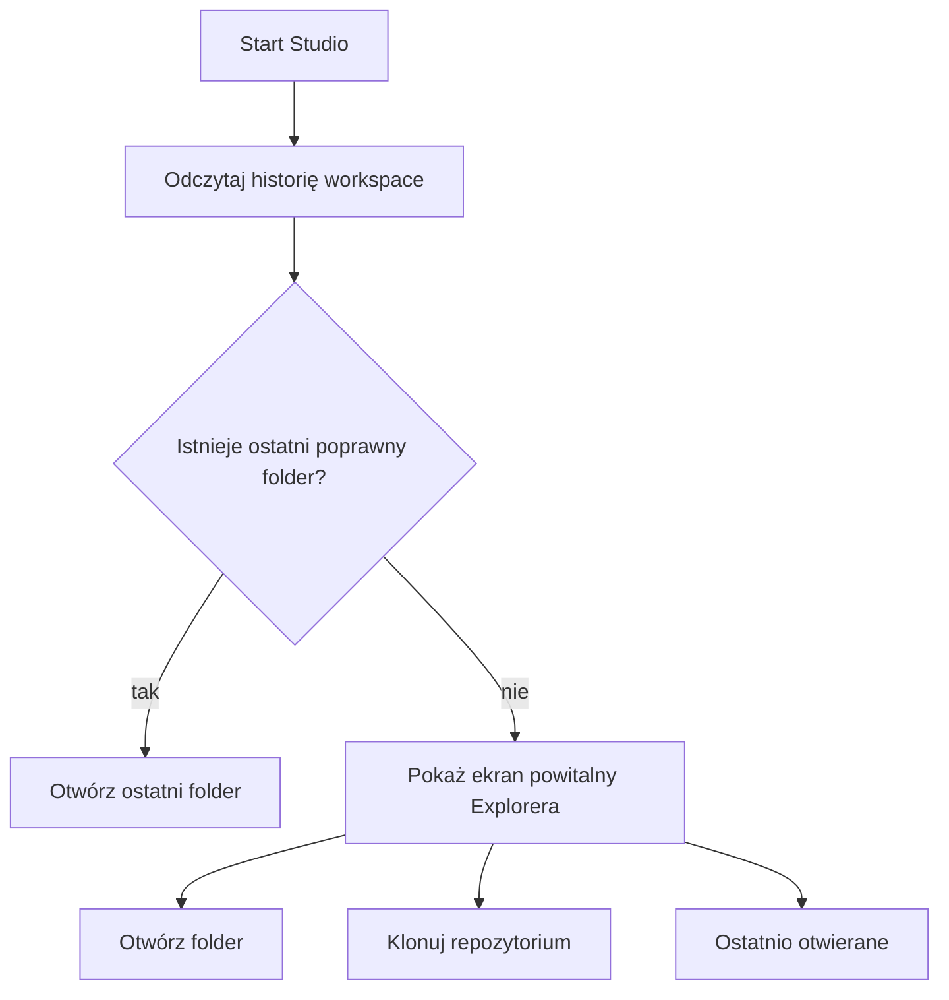
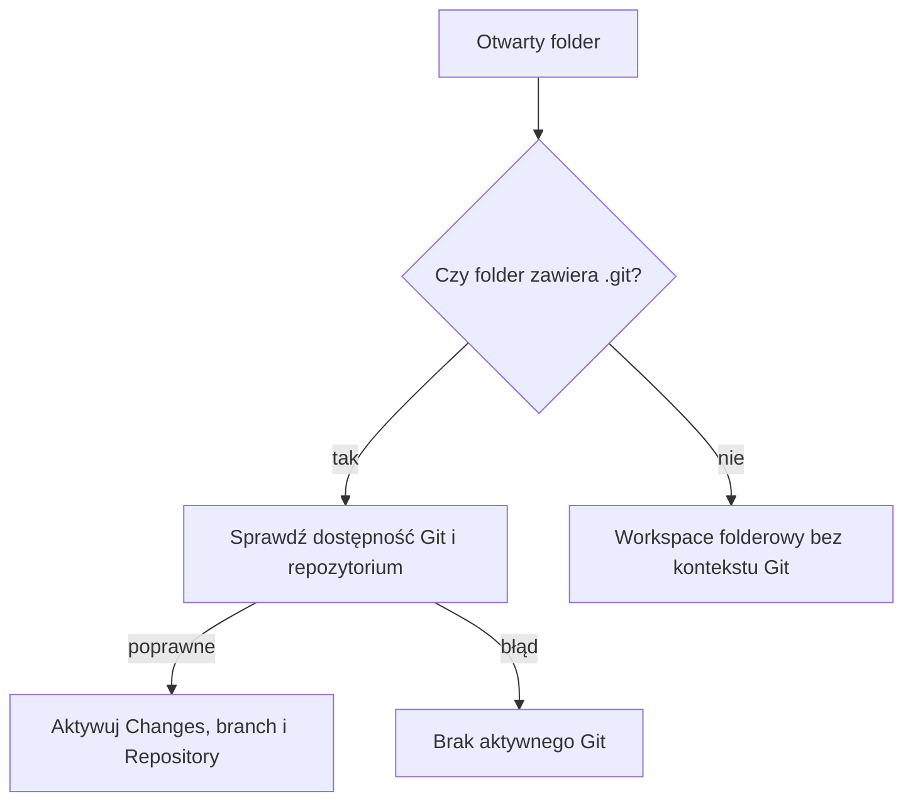

# Workspace i repozytorium — przepływ użytkownika

Ten dokument opisuje drogę od uruchomienia Junexis Studio do aktywnego
workspace i opcjonalnego kontekstu Git. Workspace jest folderem pracy
użytkownika. Repozytorium Git jest dodatkową capability aktywowaną wyłącznie
wtedy, gdy otwarty folder jest katalogiem głównym repozytorium.

## Start aplikacji

Studio nie używa katalogu uruchomieniowego procesu jako projektu.

Historia przechowuje maksymalnie 10 istniejących folderów, od najnowszego.
Duplikaty są usuwane. Usunięte lub niedostępne katalogi nie są prezentowane.
Stan jest przechowywany w pliku `workspace-state.json` w katalogu danych
użytkownika `JunexisStudio`.

## Otwórz folder

1. Wybierz **Workspace → Open Folder...** albo **Otwórz folder** na ekranie
   powitalnym.
2. Natywny dialog rozpoczyna nawigację w katalogu domowym użytkownika.
3. Wskaż katalog projektu lub repozytorium.
4. Jeśli są otwarte zmienione dokumenty, Studio pyta osobno o ich zapisanie,
   porzucenie zmian albo anulowanie operacji.
5. Po akceptacji Studio ustawia nowy root workspace, odświeża Explorer i
   publikuje `WorkspaceOpenedEvent`.
6. Pełna ścieżka aktywnego folderu pojawia się na pasku stanu.

Wybranie **Cancel** przy dowolnej niezapisanej karcie zatrzymuje całą zmianę
workspace. Poprzedni folder pozostaje aktywny.

## Ostatnio otwierane

Na pustym ekranie Explorera sekcja **OSTATNIO OTWIERANE** pokazuje nazwę oraz
pełną ścieżkę każdego dostępnego folderu. Kliknięcie pozycji korzysta z tego
samego bezpiecznego przepływu przełączenia co **Open Folder**; nie omija
potwierdzeń niezapisanych dokumentów.

## Klonuj repozytorium

1. Wybierz **Workspace → Clone Repository...** albo **Klonuj repozytorium**.
2. Podaj URL obsługiwany przez Git, na przykład HTTPS albo SSH.
3. Wskaż katalog nadrzędny. Dialog rozpoczyna w katalogu domowym.
4. Studio wyprowadza nazwę katalogu docelowego z URL-u i nie nadpisuje
   istniejącego pliku ani folderu.
5. `git clone --progress` działa poza wątkiem UI. Postęp trafia do kanału
   **Git Clone**.
6. Po sukcesie Studio sprawdza znacznik `.git` i otwiera sklonowany katalog
   przez standardowy przepływ zmiany workspace.

Argumenty Git są przekazywane strukturalnie, bez składania polecenia powłoki.
URL repozytorium jest maskowany w logach procesu, aby ograniczyć ryzyko
ujawnienia credentials osadzonych w URL-u.

## Kiedy aktywuje się Git

Studio sprawdza znacznik `.git` bezpośrednio w otwartym folderze:

- katalog `.git` oznacza standardowe repozytorium,
- plik `.git` obsługuje Git worktree i submodule,
- `.git` istniejący wyłącznie w katalogu nadrzędnym nie aktywuje Git.

Ostatnia reguła jest celowa. Otwarcie `repo/src` tworzy zwykły workspace
folderowy, ale nie udaje kontekstu całego repozytorium. Aby używać paneli
Changes i Repository, należy otworzyć `repo`, czyli katalog zawierający
bezpośredni znacznik `.git`.

Bez aktywnego kontekstu Git:

- Explorer i edytor nadal działają,
- build, debugger i Mentor nadal używają workspace,
- panel Changes pokazuje `Folder is not a Git repository (.git not found)`,
- stage, commit, diff oraz pozostałe mutacje Git są blokowane.

## Co przełącza `WorkspaceOpenedEvent`

Zmiana folderu jest zmianą kontekstu całego Studio. Zdarzenie pozwala
niezależnym modułom odświeżyć między innymi:

- drzewo Explorera,
- snapshot Git i dekoracje plików,
- konfiguracje debuggera, breakpointy i watches,
- ustawienia oraz artefakty zależne od workspace,
- auto-build,
- kontekst Mentora i OMWiA.

Moduły reagują przez eventy i capability. Workspace nie zależy bezpośrednio od
Git, debuggera ani Mentora.

## Układ Studio

Domyślny układ jest zbliżony do pracy w VS Code:

- Explorer zajmuje pełną wysokość lewej kolumny,
- edytor znajduje się w centrum,
- Output, Problems, Terminal, Toolchains i pozostałe narzędzia dolne zajmują
  szerokość obszaru edytora,
- Debug, Changes, OMWiA i OMWiA Chat są zakładkami prawego panelu,
- szerokość Explorera i prawego panelu oraz wysokość panelu dolnego są
  zapisywane przy zamknięciu.

Rozmiary są przechowywane w `shell-layout.json` w katalogu danych użytkownika
`JunexisStudio`.

## Powiązane dokumenty

- [Podręcznik użytkownika](USER_GUIDE.md)
- [Shell i system paneli](rozdzialy/04_Shell_i_System_Paneli.md)
- [Workspace i system plików](rozdzialy/05_Workspace_i_System_Plikow.md)
- [System kontroli wersji](rozdzialy/10_System_Kontroli_Wersji_jako_Rozszerzenie.md)
- [Rozwiązywanie problemów](TROUBLESHOOTING.md)
